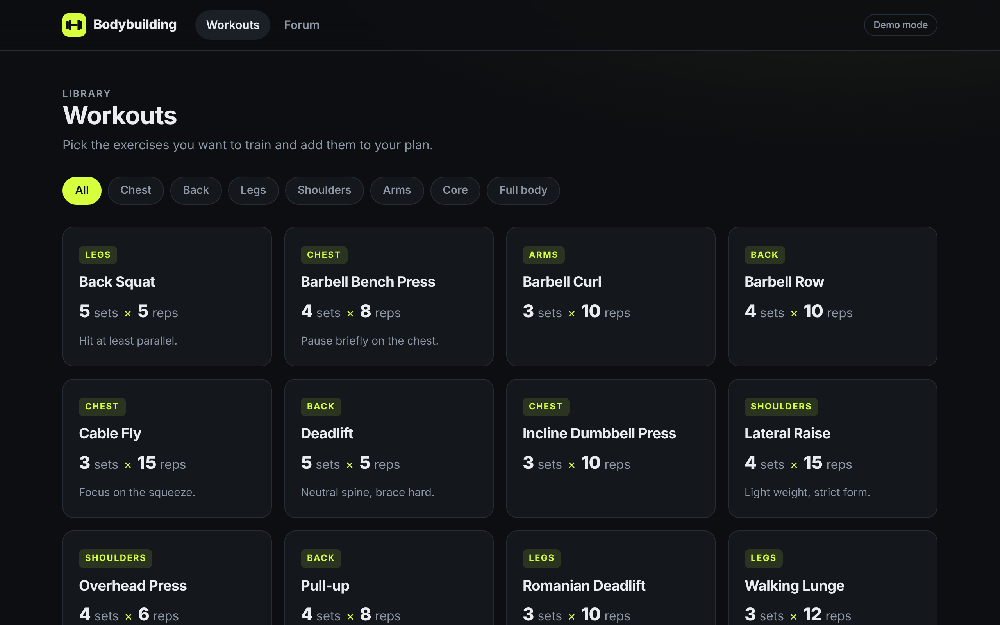
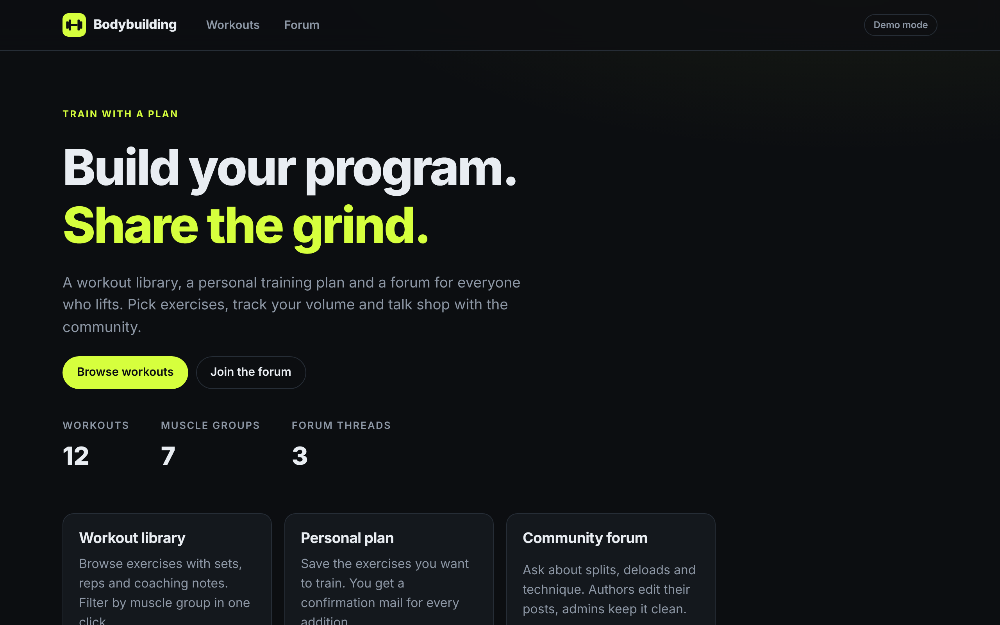
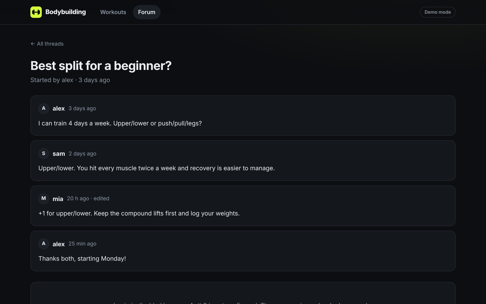
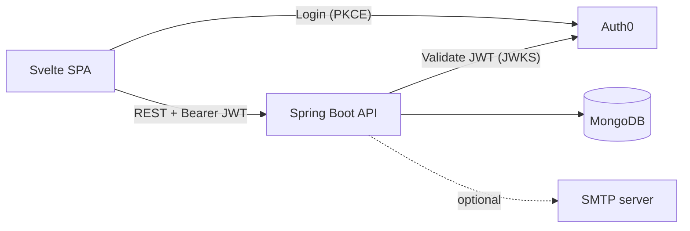

# Bodybuilding

[](https://github.com/KypleeFearz/bodybuilding/actions/workflows/ci.yml)


A full-stack web app for people who lift: a shared **workout library**, a **personal training plan** and a
**community forum**. Spring Boot REST API with MongoDB, Svelte 5 single-page app, Auth0 login with
role-based access, packaged as one Docker image.



<table>
  <tr>
    <td></td>
    <td></td>
  </tr>
</table>

## Features

- **Workout library** with sets, reps, coaching notes and a muscle group filter
- **Personal plan**: save workouts, see total sets and reps, get an e-mail for every addition
- **Forum** with threads and replies. Authors edit and delete their own posts, admins moderate
- **Roles** from Auth0 (`admin` manages the library and users)
- **Demo mode**: runs without any Auth0 account, read-only with sample data
- **OpenAPI docs** at `/swagger-ui.html`

## Tech stack

| Layer    | Technology                                                                   |
| -------- | ---------------------------------------------------------------------------- |
| Backend  | Java 21, Spring Boot 3.5, Spring Security (OAuth2 resource server), Spring Data MongoDB, Bean Validation, springdoc-openapi |
| Frontend | Svelte 5 (runes), TypeScript, Vite, Auth0 SPA SDK                             |
| Data     | MongoDB 7                                                                    |
| Testing  | JUnit 5, Mockito, MockMvc, Testcontainers, Vitest                            |
| Delivery | Multi-stage Docker build, Docker Compose, GitHub Actions, Dependabot         |

## Architecture



- The frontend is built by Vite and served by Spring Boot as static files, so the whole app is one container.
- The API is stateless: every request carries an Auth0 **access token**. User identity is always taken from
  the token, never from the request body, so nobody can act on behalf of someone else.
- Profiles are created on first login and keyed by the Auth0 subject.
- Forum posts are embedded in their thread document. Optimistic locking (`@Version`) prevents lost updates
  when two people reply at the same time.
- Errors follow [RFC 9457 problem details](https://www.rfc-editor.org/rfc/rfc9457), including field errors
  for validation failures.

## Quick start

Requirements: Docker.

```bash
git clone https://github.com/KypleeFearz/bodybuilding.git
cd bodybuilding
docker compose up --build
```

Open <http://localhost:8080>. The app starts in demo mode with sample workouts and threads.
To enable login, follow [docs/auth0-setup.md](docs/auth0-setup.md) and put your values into `.env`
(see [.env.example](.env.example)).

## Local development

Requirements: Java 21, Node.js 20.19+, Docker (for MongoDB and the integration tests).

```bash
# 1. MongoDB
docker compose up -d mongo   # or any local MongoDB on port 27017

# 2. Backend on http://localhost:8080
cd backend
SEED_DEMO_DATA=true ./mvnw spring-boot:run

# 3. Frontend with hot reload on http://localhost:5173 (proxies /api to the backend)
cd frontend
npm install
npm run dev
```

## Configuration

All settings are environment variables.

| Variable                       | Default                                  | Description                                  |
| ------------------------------ | ---------------------------------------- | -------------------------------------------- |
| `MONGODB_URI`                  | `mongodb://localhost:27017/bodybuilding` | MongoDB connection string                    |
| `AUTH0_DOMAIN`                 | empty (demo mode)                        | Auth0 tenant domain                          |
| `AUTH0_CLIENT_ID`              | empty (demo mode)                        | Client id of the Auth0 SPA                   |
| `AUTH0_AUDIENCE`               | `https://bodybuilding-api`               | Identifier of the Auth0 API                  |
| `AUTH0_CLAIM_NAMESPACE`        | `https://bodybuilding.app/`              | Namespace of the custom claims               |
| `SPRING_MAIL_HOST` and friends | not set                                  | Enables e-mail notifications                 |
| `MAIL_FROM`                    | `no-reply@bodybuilding.local`            | Sender address                               |
| `SEED_DEMO_DATA`               | `false` (`true` in Docker Compose)       | Inserts sample data into an empty database   |

## API overview

Full interactive documentation: <http://localhost:8080/swagger-ui.html>

| Method   | Path                                   | Access         |
| -------- | -------------------------------------- | -------------- |
| `GET`    | `/api/workouts?muscleGroup=LEGS`       | public         |
| `POST`   | `/api/workouts`                        | admin          |
| `DELETE` | `/api/workouts/{id}`                   | admin          |
| `GET`    | `/api/me`, `/api/me/plan`              | logged in      |
| `PUT`    | `/api/me/plan/{workoutId}`             | logged in      |
| `DELETE` | `/api/me/plan/{workoutId}`             | logged in      |
| `GET`    | `/api/threads`, `/api/threads/{id}`    | public         |
| `POST`   | `/api/threads`, `/api/threads/{id}/posts` | logged in   |
| `PUT`    | `/api/threads/{id}/posts/{postId}`     | author         |
| `DELETE` | `/api/threads/{id}`, `.../posts/{postId}` | author or admin |
| `GET`    | `/api/admin/users`                     | admin          |
| `DELETE` | `/api/admin/users/{id}`                | admin          |

## Tests

```bash
cd backend && ./mvnw verify    # unit, web layer and Testcontainers tests + JaCoCo report
cd frontend && npm test        # Vitest
cd frontend && npm run check   # svelte-check / TypeScript
```

The integration tests start a real MongoDB with Testcontainers and are skipped automatically when Docker
is not available. CI runs all of them on every push.

## Project structure

```
├── backend/                  Spring Boot API
│   └── src/main/java/io/github/kypleefearz/bodybuilding/
│       ├── auth/             CurrentUser from the JWT
│       ├── common/           Error handling
│       ├── config/           Security, OpenAPI, runtime client config
│       ├── forum/            Threads and posts
│       ├── notification/     E-mail notifications
│       ├── user/             Profiles, personal plan, admin
│       └── workout/          Workout library
├── frontend/                 Svelte 5 SPA
│   └── src/{lib,pages,components}
├── docs/                     Auth0 guide and screenshots
├── Dockerfile                Multi-stage build (Node → Maven → JRE)
└── docker-compose.yml        App + MongoDB
```

## Background

I started this project in 2023 as a semester project during my bachelor's studies. In 2026 I rewrote
it from scratch to bring it up to current standards: Java 21 and Spring Boot 3.5, Svelte 5 with TypeScript,
token-based ownership checks, proper REST semantics, configuration through environment variables, automated
tests with Testcontainers and a CI pipeline.

## License

[MIT](LICENSE)
